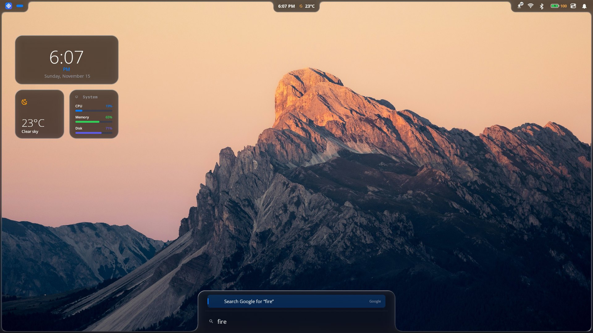
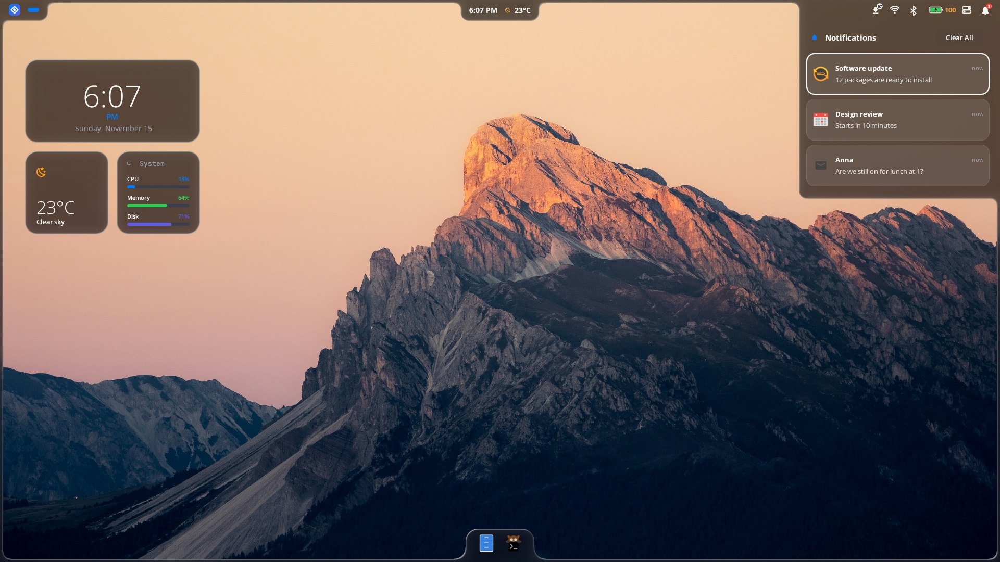
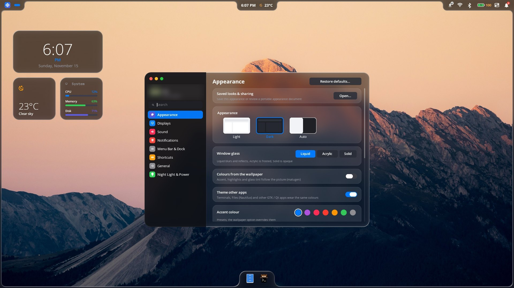

# Beskar

A macOS-style glass desktop shell for the [niri](https://github.com/YaLTeR/niri) Wayland compositor,
written in [pleamar](https://github.com/k4ditano/pleamar): declarative scenes (`.plm`) drawn on the GPU,
with small sandboxed Luau scripts (`.luau`) for the logic.

It is one thin glass **frame** round the whole screen (a ring, three islands hanging from the top, a dock
rising from the bottom), plus the panels you open from it: Control Center, notifications, Spotlight,
clipboard history, wallpapers, Settings and a lock screen. It looks like a Mac, but it is its own thing: nothing
is named after Apple, and nothing is hard-coded to one machine.

> **Status:** a personal project under active development, tested on one machine (CachyOS, niri,
> two monitors). Expect rough edges. Issues and pull requests are welcome.

<p align="center">
  
</p>

---

## Screenshots

<table>
  <tr>
    <td width="50%"><br><sub><b>Control Center</b>: Wi-Fi, Bluetooth, now playing, Do Not Disturb, dark mode, brightness and volume. It grows out of the right island.</sub></td>
    <td width="50%"><br><sub><b>Spotlight</b>: apps, windows (<code>@</code>), settings (<code>?</code>), files (<code>/</code>), commands (<code>&gt;</code>), calculator and web search. It rises out of the dock.</sub></td>
  </tr>
  <tr>
    <td><br><sub><b>Wallpapers</b>: a strip you move through with the keyboard (Up / Down change section, Left / Right move inside it), with filters, favourites and transitions.</sub></td>
    <td><br><sub><b>Today</b>: weather, calendar, notes, to-dos, system activity and battery, from a click on the clock.</sub></td>
  </tr>
  <tr>
    <td><br><sub><b>Notifications</b>: the shell is the notification server; cards with actions, history and Do Not Disturb.</sub></td>
    <td><br><sub><b>Session menu</b>: lock, sleep, log out, restart and shut down, all from the keyboard.</sub></td>
  </tr>
  <tr>
    <td colspan="2" align="center"><br><sub><b>Settings</b>: appearance, displays, sound, notifications, menu bar and dock, shortcuts, night light and power.</sub></td>
  </tr>
</table>

## Keyboard

Every panel works from the keyboard, on every monitor. The same keys everywhere:

| Key | Does |
| :--- | :--- |
| `Up` / `Down` | Move between items in a list, or between **sections** in a panel with several rows (the wallpaper strip: tabs, strip, transition, actions) |
| `Left` / `Right` | Move along a row (the strip, a set of tabs, sliders in 5 % steps) |
| `Tab` / `Shift+Tab` | Next / previous item |
| `Enter` / `Space` | Activate the focused item |
| `Home` / `End`, `PgUp` / `PgDn` | First / last, a page at a time, in lists that scroll |
| `Esc` | Go back a level, then close |

One white ring always shows where the focus is.

---

## What's in it

- **A glass frame** round the whole screen: three islands hanging from the top bar, a dock rising from the bottom. The left island has the menu and workspaces, the centre one the clock, weather and live activity (notifications, volume, music, timer), the right one the tray, Wi-Fi, battery and Control Center. Panels grow out of the island or dock they belong to, as one piece of glass.
- **Panels:** Control Center, notification centre, Today, Spotlight (apps, windows, files, settings, calculator, web search), clipboard history, wallpaper picker, timer, notes and to-dos, app switcher, window overview, Settings, session menu and lock screen.
- **Desktop widgets** you place and arrange yourself (clock, calendar, weather, system, music, notes, timer).
- **One colour system:** dark / light / auto, three glass skins, and an accent that can follow your wallpaper. Terminals, GTK and Qt apps can wear the same colours.
- **Does not need a second desktop environment:** it is the notification server, the polkit agent, the wallpaper, the lock screen and the screenshot tool.

| Panel | Opens with |
| :--- | :--- |
| Control Center | the switches icon, `Super+Shift+C` |
| Notifications | the bell, `Super+N` |
| Spotlight | `Super+Space` |
| Clipboard | `Super+V` |
| Wallpapers | `Super+W` |
| Session menu | `Super+Shift+Q` or `Super+X` |
| App switcher | `Super+Tab` |
| Settings | `Super+,` |
| Lock | `Super+Alt+L` |

---

## Install

```bash
git clone https://github.com/neerajlovecyber/beskar
cd beskar
./beskar install      # packages, cursor and icons, builds pleamar, wires niri (a backup is kept)
./beskar start        # or log out and back in
```

You need **niri** (26.04 or newer) and a GPU with a Vulkan driver. `./beskar install` asks before each step
(`--yes` answers them all, `--dry-run` only lists them, `--no-packages` skips the package step). On Arch it installs everything the
shell uses, including the fonts, the Bibata cursor and Papirus icons (only if you have not chosen your own), and builds the
pinned [pleamar](https://github.com/k4ditano/pleamar) (**0.8.0-exp.21**) with Rust. Other distributions get the package list to
translate.

| Command | Does |
| :--- | :--- |
| `./beskar doctor` | Checks what is installed and what is missing |
| `./beskar update` | Pulls the newest Beskar and pleamar, restarts the shell |
| `./beskar uninstall` | Takes the niri lines out again (your data stays) |
| `./beskar start` / `stop` / `restart` / `lock` / `settings` | Drive the shell |

The install writes the shortcuts into `~/.config/niri/beskar.kdl` (yours to edit) and includes it from `config.kdl`.

---

## Configuring it

Settings does most of it. Everything is plain files under your home:

| File | What it holds |
| :--- | :--- |
| `~/.config/beskar/prefs.json` | Bar, notification and general preferences (written by Settings) |
| `~/.config/pleamar_shell.json` | Dark mode, glass skin and accent |
| `~/.config/beskar/dock` | Pinned dock apps, one desktop id per line |
| `~/.config/beskar/location` | `LAT LON City` for the weather (otherwise looked up once from your IP) |
| `~/Pictures/wallpapers` | Your wallpapers; the built-in ones are copied to `~/.local/share/beskar/wallpapers` |

---

## How it is built

Scenes (`.plm`) draw the shell on the GPU and small Luau scripts (`.luau`) hold the logic. The frame, panels, Settings and the
shared owners (weather, timer, notes, system services) run in one process, `shell/desktop.plm`; the wallpaper, widgets and lock
screen run on their own. To change something, read [`AGENTS.md`](AGENTS.md) first: it lists the tools and the pitfalls. Design
notes are in [`docs/`](docs/) ([UI standards](docs/UI_STANDARDS.md), [components](docs/COMPONENT_LIBRARY.md),
[session menu](docs/SESSION_MENU.md), [weather](docs/WEATHER.md), [timers](docs/TIMERS.md)).

---

## Credits

- [pleamar](https://github.com/k4ditano/pleamar) by k4ditano, the runtime and language
- [Marea](https://github.com/k4ditano/marea-plm), the reference for notifications, wallpapers, Bluetooth and Wi-Fi handling
- [iNiR](https://github.com/snowarch/iNiR) (GPL-3.0), for the island and frame ideas and the built-in wallpapers;
  artwork credit belongs to the original artists
- The macOS design language is the inspiration; Beskar is not affiliated with Apple
