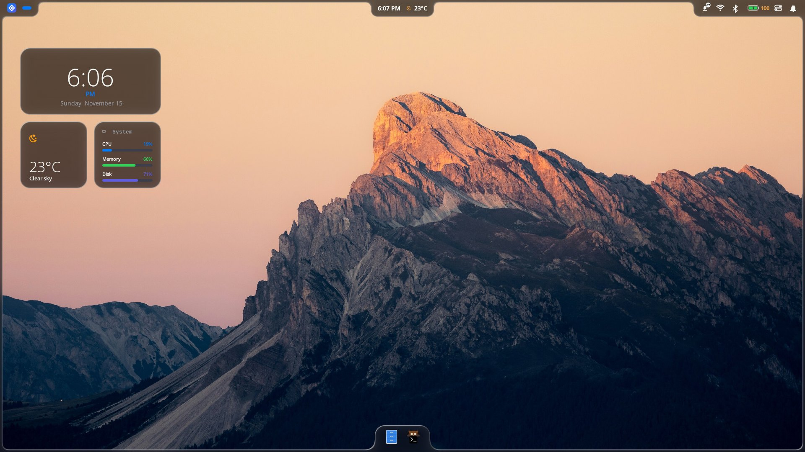
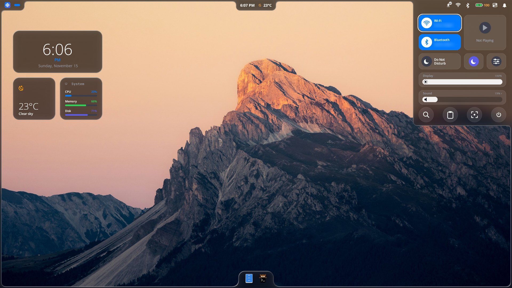
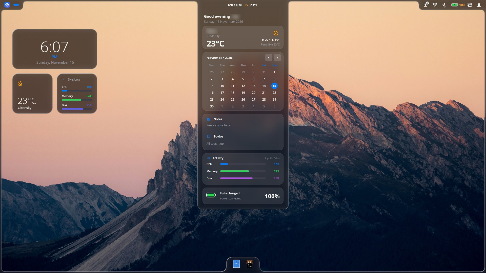
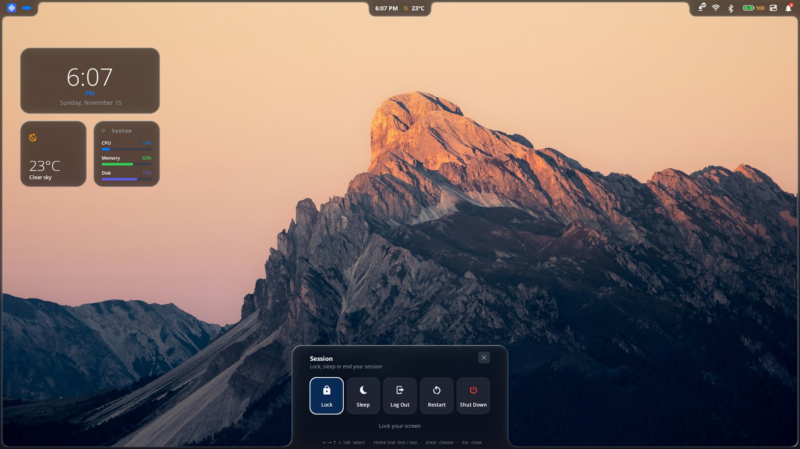

# Beskar

A macOS-style glass desktop shell for the [niri](https://github.com/YaLTeR/niri) Wayland compositor,
written in [pleamar](https://github.com/k4ditano/pleamar): declarative scenes (`.plm`) drawn on the GPU,
with small sandboxed Luau scripts (`.luau`) for the logic.

It is one thin glass **frame** round the whole screen (a ring, three islands hanging from the top, a dock
rising from the bottom), plus the panels you open from it: Control Center, notifications, Spotlight,
clipboard history, wallpapers, Settings and a lock screen. It looks like a Mac, but it is its own thing: nothing
is named after Apple, and nothing is hard-coded to one machine.

> **Status:** a personal project under active development, tested on one machine (CachyOS, niri,
> two monitors). Expect rough edges. Issues and pull requests are welcome.

<p align="center">
  
</p>

---

## Screenshots

<table>
  <tr>
    <td width="50%"><br><sub><b>Control Center</b>: Wi-Fi, Bluetooth, now playing, Do Not Disturb, dark mode, brightness and volume. It grows out of the right island.</sub></td>
    <td width="50%"><br><sub><b>Spotlight</b>: apps, windows (<code>@</code>), settings (<code>?</code>), files (<code>/</code>), commands (<code>&gt;</code>), calculator and web search. It rises out of the dock.</sub></td>
  </tr>
  <tr>
    <td><br><sub><b>Wallpapers</b>: a strip you move through with the keyboard (Up / Down change section, Left / Right move inside it), with filters, favourites and transitions.</sub></td>
    <td><br><sub><b>Today</b>: weather, calendar, notes, to-dos, system activity and battery, from a click on the clock.</sub></td>
  </tr>
  <tr>
    <td><br><sub><b>Notifications</b>: the shell is the notification server; cards with actions, history and Do Not Disturb.</sub></td>
    <td><br><sub><b>Session menu</b>: lock, sleep, log out, restart and shut down, all from the keyboard.</sub></td>
  </tr>
  <tr>
    <td colspan="2" align="center"><br><sub><b>Settings</b>: appearance, displays, sound, notifications, menu bar and dock, shortcuts, night light and power.</sub></td>
  </tr>
</table>

## Keyboard

Every panel works from the keyboard, on every monitor. The same keys everywhere:

| Key | Does |
| :--- | :--- |
| `Up` / `Down` | Move between items in a list, or between **sections** in a panel with several rows (the wallpaper strip: tabs, strip, transition, actions) |
| `Left` / `Right` | Move along a row (the strip, a set of tabs, sliders in 5 % steps) |
| `Tab` / `Shift+Tab` | Next / previous item |
| `Enter` / `Space` | Activate the focused item |
| `Home` / `End`, `PgUp` / `PgDn` | First / last, a page at a time, in lists that scroll |
| `Esc` | Go back a level, then close |

One white ring always shows where the focus is.

---

## What's in it

**The frame** (`shell/topbar.plm`) is a single glass silhouette, so every junction melts into the next:

- **Left island:** the gem button (About, Settings, Edit Widgets and the keyboard-driven Session menu), a capsule per workspace of the monitor it is on, then the icons of the apps open in the current workspace (the focused one highlighted).
- **Centre island:** date, time and weather. Click it for the dashboard. It also shows new notifications and the volume / brightness feedback, growing around them.
- **Right island:** tray apps, Wi-Fi (with signal), Bluetooth while a device is connected, battery, Control
  Center, and the notification bell (with an unread count and a Do Not Disturb slash). Each icon does
  something when clicked.
- **Dock:** starts with a file manager and a terminal. Running apps appear with a dot; click to focus or launch,
  right-click to *Keep in Dock* / *Remove from Dock* / *Quit*. It hides while a window is on the monitor and
  comes back when the pointer reaches the bottom edge.
- Islands are as wide as their content and morph with springs when it changes.

**Panels** (one open at a time, the others close). The power menu, Control Center, dashboard and notification centre all grow out of the bar's islands: the island itself stretches down into the panel, as one piece of glass:

| Panel | Opens with | What it does |
| :--- | :--- | :--- |
| **Control Center** | the switches icon, the Wi-Fi / Bluetooth icons, `Super+Shift+C` | Wi-Fi and Bluetooth (join networks with a password, connect, pair, per-app volume), Now Playing with seek, Do Not Disturb, dark mode, brightness and volume sliders, shortcuts |
| **Notifications** | the bell, `Super+N` | The notification server; grows out of the right island. Cards with icon, title and body, hover ×, Clear All, a saved history ("Earlier"), a banner that appears inside the centre pill |
| **Dashboard** | click the clock | Date, live weather, CPU / memory / disk, battery, clocks |
| **Spotlight** | `Super+Space` | Apps with recent/frequent ranking, open windows (`@`), Settings (`?`), files/folders (`/`), commands (`>`), calculator and web searches |
| **Timer** | Spotlight → Timer, timer pill/widget, `./beskar timer` | Presets and custom duration, pause/resume/cancel, saved deadline across sleep and restart; [timer contract](docs/TIMERS.md) |
| **Clipboard** | `Super+V` | Clipboard history (cliphist) |
| **Wallpapers** | `Super+W` | Thumbnails, favourites and unavailable-file states; validated Circle/Fade/Wipe transitions and previous-picture restore |
| **Settings** | Control Center → Settings | Searchable Appearance controls, safe restore/undo, saved looks and appearance sharing, display Keep/Revert, sound, quiet modes/hours/app delivery, bar/dock controls and owned shortcuts |
| **Session menu** | `Super+Shift+Q` / `Super+X`, gem menu → Session…, Control Center power button | Dock chooser for Lock, Sleep, Log Out, Restart and Shut Down; arrows/Tab, Enter, Escape |
| **Lock screen** | `start.sh lock` | `ext-session-lock`, password checked by PAM |
| **Also** | | App switcher, screenshot / screen-recording toolbar, session (shut down / restart / log out) dialog |

**One colour system** (`shell/common/theme.plm`): dark mode, three glass skins and seven accent colours reach every
scene. The accent can follow your wallpaper.

**One geometry system** (`shell/common/geometry.plm`) supplies shared spacing,
control sizes, corners and typography. New UI follows [UI standards](docs/UI_STANDARDS.md);
`python3 shell/check-ui.py` checks those conventions and runs with panel smoke checks.

---

## Spotlight file search

Type `/ report` in Spotlight to find filenames and folders under your home directory. A result shows its parent folder; Enter opens it with your usual application or file manager. `/ Documents/report` also matches a path within the search folders.

Queries wait 300 ms after typing, return at most 24 results, search up to eight directory levels and stop after two seconds. Hidden files, ignore rules, dependency/build folders, symlinked directories and other mounted filesystems are skipped. A timeout is labelled, and changing modes or closing Spotlight discards late results. File queries and paths are not added to app history.

To restrict searches, put `spotlight-files.json` in the dock panel scene's data directory (normally `~/.local/share/pleamar/dockpanels/`, or under `$XDG_DATA_HOME/pleamar/dockpanels/`):

```json
{ "roots": ["~/Documents", "~/Downloads"] }
```

Use one to eight existing folders, as absolute paths or `~/` paths. Each selected folder is searched on its own filesystem. With no roots configured, Spotlight searches your home directory.

---

## Requirements

- **niri** (workspaces, windows and outputs are read with `niri msg`)
- **[pleamar](https://github.com/k4ditano/pleamar)**, **0.8.0-exp.21**, built from source: needs a Rust toolchain. `./beskar install`
  (or the first start) fetches the pinned tag and builds it into `bin/exp/`; `./beskar update` keeps that pin.
- **matugen** (colours from the wallpaper), **ImageMagick** (`magick`), **fd**, **GNU timeout** (coreutils), **curl**
- **grim**, **slurp** and **wf-recorder** (screenshots and recording), **wl-clipboard** and **cliphist** (clipboard)
- A **Nerd Font** (a few status glyphs), and a PipeWire/PulseAudio, NetworkManager and BlueZ desktop for the
  audio, Wi-Fi and Bluetooth pages
- Optional: `yay` / `paru` / `pacman` for the software-update page

## Install and run

```bash
git clone https://github.com/neerajlovecyber/beskar
cd beskar
./beskar install      # packages, cursor + icons + app themes, builds pleamar, wires niri (a backup is kept), checks everything
./beskar start        # or log out and back in
```

`./beskar install` asks before each step (`--yes` answers them all, `--dry-run` only lists what it would do,
`--no-packages` skips the package step). On Arch it installs what the shell uses with `pacman` (and the cursor theme from the
AUR with `paru` / `yay`): a Vulkan driver for your GPU (pleamar draws with Vulkan; without one nothing starts), the
fonts (JetBrainsMono Nerd Font), the **Bibata-Modern-Ice cursor** and **Papirus-Dark icons** (set only if you have not
chosen your own), `adw-gtk-theme` and `qt5ct` / `qt6ct` (other apps wear the shell's colours), the portals and
polkit, NetworkManager / BlueZ / power-profiles-daemon / UPower, grim / slurp / wf-recorder, cliphist and the rest. On
other distributions it prints the same list to translate. `./beskar uninstall` takes the niri include lines out again.

`./beskar doctor` lists what is installed and what is missing (with the pacman line for Arch), `./beskar update` pulls
the newest Beskar and pleamar, rebuilds if needed and restarts the shell, `./beskar welcome` shows the first-run
welcome again. `start`, `stop`, `restart`, `status`, `lock`, `settings`, … go to `shell/start.sh`.

### niri configuration

`./beskar install` writes this for you into `~/.config/niri/beskar.kdl` and includes it from `config.kdl` (it leaves a config that already starts the shell alone). To do it by hand, add the shortcuts (use your own path) and keep windows clear of the 6 px ring:

```kdl
layout {
    struts { left 6; right 6; bottom 6; }
}

binds {
    Mod+Space       { spawn "/path/to/beskar/shell/start.sh" "spotlight"; }
    Mod+V           { spawn "/path/to/beskar/shell/start.sh" "clipboard"; }
    Mod+N           { spawn "/path/to/beskar/shell/start.sh" "notifications"; }
    Mod+W           { spawn "/path/to/beskar/shell/start.sh" "wallpapers"; }
    Mod+Shift+C     { spawn "/path/to/beskar/shell/start.sh" "control-center"; }
    Mod+Shift+Q repeat=false { spawn "/path/to/beskar/shell/start.sh" "power-menu"; }
    Mod+X repeat=false { spawn "/path/to/beskar/shell/start.sh" "power-menu"; }
    Mod+Alt+L repeat=false { spawn "/path/to/beskar/shell/start.sh" "lock"; }
}
```

The other commands: `settings`, `lock`, `session [0|1|2|3]`, `capture`, `appswitcher`, `dashboard`,
`vol-up|vol-down|mute`, `bright-up|bright-down`, `dark-mode [on|off]`, `skin [0|1|2]`.

See [Session menu and shortcuts](docs/SESSION_MENU.md) for navigation, confirmation
behaviour, routes and the reference-shell decisions.

---

## Shared weather

The menu bar, Today, weather panel and desktop widgets share one forecast and location.
Click the weather chip for eight hourly readings and a five-day outlook, including rain
chance, temperatures in °C, wind in km/h and the last update time. **Change** selects a
city or looks up your location from your IP address; **Refresh** updates the shared forecast.
Forecast hours and sunrise/sunset follow the 12/24-hour clock preference.

Forecasts refresh after 15 minutes. A failed request keeps the last successful reading,
labelled **Cached** (and `~` before the bar/widget temperature). The cache survives a shell
restart; widgets reconnect to the owner's snapshot without another weather API poller.
See [the weather contract](docs/WEATHER.md) for storage and event details.

## Configuring it

Everything is plain files under your home; nothing is hard-coded.

| File | What it holds |
| :--- | :--- |
| `~/.config/pleamar_shell.json` | Dark mode, glass skin, accent (written by Settings, restored by `start.sh`) |
| `~/.config/beskar/prefs.json` | Versioned frame, notification, quiet-hours and general preferences, owned by Settings |
| `~/.config/beskar/appearance-looks.json` | Up to 16 named appearance looks; sharing exports only portable appearance choices |
| `~/.config/beskar/widgets.json` | Version 2 per-output widget placement and per-card options |
| `~/.config/beskar/widget-layouts.json` | Up to 24 saved widget desktops; loading has one-step undo |
| `~/.config/beskar/dock` | Pinned dock apps, one desktop id per line (`org.gnome.Nautilus`, `kitty`, …). Delete it for the defaults |
| `~/.config/beskar/tray-hide` | Tray icons to hide, one id per line. nm-applet and blueman are hidden by default; write `-nm-applet` to show one |
| `~/.config/beskar/location` | `LAT LON City` for the weather. Without it the place is looked up once from your IP and saved here |
| `~/.config/beskar/wallpaper` | The wallpaper you picked (restored at login) |
| `~/Pictures/wallpapers` | Your wallpapers (also `~/Pictures/Wallpapers`, `~/Wallpapers`); files named *screenshot* or *mock* are skipped |
| `~/.local/share/beskar/wallpapers` | The built-in wallpapers, copied here from `assets/wallpapers/` |
| `~/.local/share/pleamar/notifications/history.json` | Dismissed notifications ("Earlier") |

---

See [Customization plan and delivered controls](docs/CUSTOMIZATION_PLAN.md) for
current limits and recovery behaviour. Edit Widgets has Widgets, Desktops and Card
tabs; the Card tab opens when you select a card during editing. Position locks affect
placement, while each clock can override date, seconds and 12/24-hour format.

## How it is built

The frame, panels, Settings and shared owners are scenes imported by `shell/desktop.plm`
into one process. They communicate through typed events. Wallpaper, widgets, lock and
the on-demand capture picker run separately. A few shared pieces keep them consistent:

| Piece | What it does |
| :--- | :--- |
| `shell/common/theme.plm` | The colour tokens and the `dark_mode` / `skin` / `accent` facts, included by every scene |
| `shell/exclusive.luau` | Opening a panel closes the others |
| `shell/weather.plm` + `.luau` | One location, forecast request and last-good cache for all weather views |
| `shell/weather_data.luau` / `weather_client.luau` | Bounded forecast data and formatting; read-only widget snapshot bridge |
| `shell/topbar.plm` + `.luau` | The frame, dock and tray in one scene (one process, drawn on every monitor) |

Shared rendering controls use `.plm` libraries inside the caller's existing surface.
See [the component library guide](docs/COMPONENT_LIBRARY.md) for ownership, reuse and performance rules.
The [macOS 26 reference](docs/DESIGN_REFERENCE.md) records the supplied Figma source and access requirements.
See [rendering notes](docs/RENDERING_NOTES.md) for the desktop buffer configuration and closed-panel ghost fix.
The [customization plan](docs/CUSTOMIZATION_PLAN.md) compares current controls with the local iNiR reference
and sets the next steps for searchable settings, wallpaper, bar/dock options and saved desktops.

```text
beskar/
├── assets/wallpapers/       built-in wallpapers (from iNiR, see its README)
├── shell/
│   ├── common/theme.plm     colours
│   ├── *.plm                one scene per panel
│   ├── *.luau               each scene's logic
│   └── start.sh             starts, stops and drives everything
├── docs/                    pleamar's language notes and recipes
├── AGENTS.md                the rules and pitfalls learned while building this
└── bin/                     the pleamar binary (not committed)
```

If you want to change something, read [`AGENTS.md`](AGENTS.md) first: it lists the tools
(`pleamar --check`, `--say … describe`) and the pitfalls (right-click quits a scene unless it has an
`on press right` rule, props on per-monitor surfaces, the Luau sandbox, …).

---

## Credits

- [pleamar](https://github.com/k4ditano/pleamar) by k4ditano, the runtime and language
- [Marea](https://github.com/k4ditano/marea-plm), the reference for notifications, wallpapers, Bluetooth and Wi-Fi handling
- [iNiR](https://github.com/snowarch/iNiR) (GPL-3.0), for the island and frame ideas and the built-in wallpapers;
  artwork credit belongs to the original artists
- The macOS design language is the inspiration; Beskar is not affiliated with Apple

There is no licence file for this repository yet.

### Notes and to-dos

Open Today from the clock and choose **Notes** or **To-dos**, or search **Notes & To-dos** in Spotlight. The shared editor saves changes automatically on this device. Notes support multiple lines, create/remove and Undo; to-dos have active/completed views, checkboxes, move up/down and remove/Undo. Today shows the latest edited note and two active to-dos with working checkboxes.

Use **Edit Widgets** to add **Notes** and **To-dos** cards (medium or large). Notes shows the most recently edited note; To-dos shows up to four active items with working checkboxes. Click the card to open the same editor. Removing a card only removes its placement; the content remains available in Today and the editor.

Personal content is stored atomically by the `Personal` scene in `~/.local/share/pleamar/personal/content.json` (or `$XDG_DATA_HOME/pleamar/personal/content.json`). The widgets process reads that snapshot and requests a resync when it starts. Limits: 16 notes of up to 4096 bytes, 48 to-dos of up to 240 bytes, and 20 content Undo steps per running session. Typing in a note forms one Undo step until another content operation. Undo history is not retained after restart. Saves are debounced by 300 ms; closing the editor flushes pending changes. Failed writes retain open edits and retry; unreadable/invalid saved content is kept untouched and reported in the editor.
