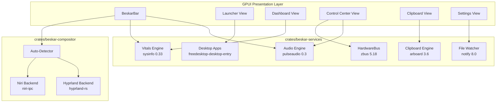

# Beskar Desktop Shell — Crate Modernization & Stability Master Plan

## 1. Executive Vision & Architecture Philosophy

Beskar is transitioning from a modular desktop prototype into a production-grade, zero-freeze Wayland desktop environment powered by GPUI and Tokio.

### The Three Core Tenets
1. **Zero External CLI Binaries**: The shell must never rely on runtime subprocesses (`curl`, `cliphist`, `wl-copy`, `nmcli`, `bluetoothctl`, `wpctl`) to function. All platform, hardware, and desktop interactions must be handled through native Rust crates or standard Linux protocols (D-Bus, Wayland IPC, Unix sockets).
2. **Zero Main-Thread Blocking**: No file I/O, network requests, hardware queries, or D-Bus roundtrips are ever executed on GPUI's UI thread (`cx.update`, `render`, or `View::new`). All background services operate asynchronously on a dedicated multi-threaded Tokio runtime and communicate with UI components via non-blocking channels (`tokio::sync::watch` or `tokio::sync::mpsc`).
3. **Deep Seams & Upstream Reference Alignment**: Architecture follows proven patterns from production reference shells (`wayle`, `gpui-shell`, `icebar`, `pleamar`). All modules are strictly bounded: public surfaces are minimal, internal implementations are deep, and all files remain strictly under 500 lines.

---

## 2. Modern Crate Foundation Matrix

| Subsystem | Legacy / Ad-Hoc Approach | Modern Crate | Version | Features / Flags | Replaced Binaries / Fragile Code | Status |
| :--- | :--- | :--- | :--- | :--- | :--- | :---: |
| **App Launcher Discovery** | Manual XDG path crawler | `freedesktop-desktop-entry` | `0.8` | Default | Manual `.desktop` line-by-line parser | **DONE** |
| **App Icon Theme Lookup** | Guessed icon filenames | `freedesktop-icons` | `0.4` | Default | Fragile hardcoded `/usr/share/pixmaps` checks | **DONE** |
| **Async Network & API** | `std::process::Command` | `reqwest` | `0.12` | `json`, `rustls-tls` | 3 blocking `curl` subprocess calls | **DONE** |
| **Network & Bluetooth** | `nmcli` & `bluetoothctl` | `zbus` | `5.18` | `tokio` | All child processes in `NetworkHelper` & `BluetoothHelper` | **DONE** |
| **Hardware System Vitals** | Unimplemented / `/proc` text | `sysinfo` | `0.33` | `component`, `disk`, `system` | Raw `/proc` parsing & blocking I/O | **PHASE 1** |
| **Hot-Reload & Watcher** | Shell restart required | `notify` | `8.0` | Default | Inotify polling loops | **PHASE 2** |
| **Wayland Clipboard** | `cliphist` & `wl-copy` | `arboard` | `3.6` | `wayland-data-control` | `cliphist list`, `cliphist decode`, `wl-copy` | **PHASE 3** |
| **Multi-Compositor IPC** | Niri-only (`niri-ipc`) | `hyprland` | `0.4.0-beta.3` | Default | Single compositor lock-in | **PHASE 4** |
| **Native Audio Engine** | Partial Unix socket / `wpctl` | `pulseaudio` | `0.3` | Default | PipeWire-pulse packet framing & CLI tools | **PHASE 5** |

---

## 3. High-Level Architecture



---

## 4. Phase-by-Phase Sub-Plans

---

### Sub-Plan Phase 1: Pure-Rust System Vitals Engine (`sysinfo`)

#### 1. Objectives & Scope
- Provide a unified, non-blocking hardware metrics engine that monitors CPU utilization, memory allocation, swap space, mounted disk consumption, and CPU temperatures.
- Expose zero-allocation, instant cached snapshots to UI components via `tokio::sync::watch` so that UI render frames execute in 0ms without file reads.

#### 2. Architecture & Seam Design
- **Module**: `crates/beskar-services/src/vitals.rs` (< 350 lines).
- **Export**: Exported through `crates/beskar-services/src/lib.rs` (`pub use vitals::{VitalsService, VitalsSnapshot, CpuMetrics, MemoryMetrics, DiskMetrics, ThermalMetrics};`).
- **Data Models**:
  ```rust
  #[derive(Debug, Clone, Default, serde::Serialize, serde::Deserialize)]
  pub struct VitalsSnapshot {
      pub cpu: CpuMetrics,
      pub memory: MemoryMetrics,
      pub swap: MemoryMetrics,
      pub disks: Vec<DiskMetrics>,
      pub thermals: Vec<ThermalMetrics>,
  }

  #[derive(Debug, Clone, Default, serde::Serialize, serde::Deserialize)]
  pub struct CpuMetrics {
      pub global_usage_percent: f32, // 0.0 .. 100.0
      pub core_usages: Vec<f32>,     // Per-core percentage
      pub physical_core_count: usize,
  }

  #[derive(Debug, Clone, Default, serde::Serialize, serde::Deserialize)]
  pub struct MemoryMetrics {
      pub used_bytes: u64,
      pub total_bytes: u64,
      pub usage_percent: f32,
      pub formatted_used: String,
      pub formatted_total: String,
  }

  #[derive(Debug, Clone, Default, serde::Serialize, serde::Deserialize)]
  pub struct DiskMetrics {
      pub mount_point: String,
      pub used_bytes: u64,
      pub total_bytes: u64,
      pub usage_percent: f32,
  }

  #[derive(Debug, Clone, Default, serde::Serialize, serde::Deserialize)]
  pub struct ThermalMetrics {
      pub label: String,
      pub temp_celsius: f32,
  }
  ```
- **Service API**:
  ```rust
  pub struct VitalsService {
      rx: tokio::sync::watch::Receiver<VitalsSnapshot>,
  }

  impl VitalsService {
      pub fn global() -> &'static Self;
      pub fn snapshot(&self) -> VitalsSnapshot;
      pub fn subscribe(&self) -> tokio::sync::watch::Receiver<VitalsSnapshot>;
  }
  ```

#### 3. Execution Checklist
- [x] Add `sysinfo = { version = "0.33", default-features = false, features = ["component", "disk", "system"] }` to root `Cargo.toml` workspace dependencies and `crates/beskar-services/Cargo.toml`.
- [x] Implement `crates/beskar-services/src/vitals.rs` with background worker refreshing at a 1500ms interval.
- [x] Export `VitalsService` and `VitalsSnapshot` in `crates/beskar-services/src/lib.rs`.
- [x] Update `DashboardWidget` (`crates/beskar-shell/src/modules/dashboard/view.rs`) to render real CPU/RAM utilization and temperature status cards.
- [x] Add unit tests verifying non-empty CPU/Memory data collection.
- [x] Validate with `cargo check --workspace` and `cargo test --workspace`.

---

### Sub-Plan Phase 2: Live Inotify Hot-Reloading & File Watcher (`notify`)

#### 1. Objectives & Scope
- Enable instant desktop theme updates, bar configuration reloads, and automatic wallpaper picker updates when files change on disk, without restarting the shell.
- Utilize Linux inotify with asynchronous event dispatch and built-in debouncing (300ms) to ignore atomic temp-file write bursts from text editors.

#### 2. Architecture & Seam Design
- **Module**: `crates/beskar-services/src/watcher.rs` (< 250 lines).
- **Watched Targets**:
  1. Config file: `~/.config/beskar/config.json` -> emits `WatchEvent::ConfigModified`.
  2. Wallpaper catalog: `~/Pictures/Wallpapers/` -> emits `WatchEvent::WallpaperDirectoryChanged`.
- **Event Dispatch**:
  ```rust
  #[derive(Debug, Clone, PartialEq, Eq)]
  pub enum WatchEvent {
      ConfigModified(std::path::PathBuf),
      WallpaperDirectoryChanged(std::path::PathBuf),
  }

  pub struct FileWatcherService;
  impl FileWatcherService {
      pub fn start() -> anyhow::Result<tokio::sync::broadcast::Receiver<WatchEvent>>;
  }
  ```

#### 3. Execution Checklist
- [x] Add `notify = "8.0"` to root `Cargo.toml` and `crates/beskar-services/Cargo.toml`.
- [x] Implement `crates/beskar-services/src/watcher.rs` wrapping `notify::RecommendedWatcher`.
- [x] Export `FileWatcherService` and `WatchEvent` in `crates/beskar-services/src/lib.rs`.
- [x] Provide debounced broadcast stream for `ConfigModified` and `WallpaperDirectoryChanged`.
- [x] Write integration unit tests ensuring path structures and watcher compilation.
- [x] Validate with `cargo check --workspace`.

---

### Sub-Plan Phase 3: Zero-Dependency Embedded Wayland Clipboard (`arboard`)

#### 1. Objectives & Scope
- Completely eradicate runtime external CLI dependencies (`cliphist` and `wl-copy`) from the clipboard service.
- Implement an in-memory ring-buffer clipboard history with disk persistence in `~/.cache/beskar/clipboard_history.json`.

#### 2. Architecture & Seam Design
- **Module**: Rewrite `crates/beskar-services/src/clipboard.rs` (< 300 lines).
- **Underlying Engine**: `arboard = { version = "3.6", default-features = false, features = ["wayland-data-control"] }`.
- **State Management**:
  ```rust
  pub struct ClipboardHistory {
      entries: std::collections::VecDeque<ClipboardEntry>,
      max_entries: usize, // default: 50
  }
  ```
- **Service API**:
  ```rust
  pub struct ClipboardService;
  impl ClipboardService {
      pub fn list_history(max: usize) -> Vec<ClipboardEntry>;
      pub fn copy_item(id: &str) -> bool;
      pub fn copy_text(text: &str) -> bool;
      pub fn delete_item(id: &str) -> bool;
      pub fn clear_history() -> bool;
  }
  ```

#### 3. Execution Checklist
- [x] Add `arboard = { version = "3.6", default-features = false, features = ["wayland-data-control"] }` to root `Cargo.toml` and `crates/beskar-services/Cargo.toml`.
- [x] Refactor `crates/beskar-services/src/clipboard.rs` to remove all `Command::new("cliphist")` and `Command::new("wl-copy")` calls.
- [x] Implement local cache serialization/deserialization to `~/.cache/beskar/clipboard_history.json`.
- [x] Verify seamless integration with `crates/beskar-shell/src/modules/clipboard/view.rs`.
- [x] Add unit tests verifying push, query, and deduplication of clipboard items.
- [x] Validate with `cargo check --workspace` and `cargo test --workspace`.

---

### Sub-Plan Phase 4: Multi-Compositor IPC (`hyprland-rs`)

#### 1. Objectives & Scope
- Elevate Beskar from a Niri-only shell to a multi-compositor desktop shell supporting both Niri and Hyprland.
- Dynamically detect running compositor via environment variables (`HYPRLAND_INSTANCE_SIGNATURE` vs `NIRI_SOCKET`).
- Implement the `CompositorBackend` trait for Hyprland to stream workspaces, active window titles, and handle workspace navigation actions.

#### 2. Architecture & Seam Design
- **Module**: Create `crates/beskar-compositor/src/hyprland.rs` (< 350 lines).
- **Trait Implementation**:
  ```rust
  #[async_trait]
  impl CompositorBackend for HyprlandBackend {
      fn kind(&self) -> CompositorKind { CompositorKind::Hyprland }
      fn is_available(&self) -> bool;
      async fn start_listener(&self, tx: mpsc::Sender<CompositorEvent>) -> Result<()>;
      async fn get_workspaces(&self) -> Result<Vec<WorkspaceInfo>>;
      async fn get_windows(&self) -> Result<Vec<WindowInfo>>;
      async fn focus_workspace(&self, id: u64) -> Result<()>;
      async fn focus_window(&self, id: u64) -> Result<()>;
      async fn close_window(&self, id: u64) -> Result<()>;
  }
  ```
- **Compositor Detection**: Update `crates/beskar-compositor/src/detector.rs` to auto-select Hyprland if `HYPRLAND_INSTANCE_SIGNATURE` is present.

#### 3. Execution Checklist
- [x] Add `hyprland = "0.4.0-beta.3"` to root `Cargo.toml` and `crates/beskar-compositor/Cargo.toml`.
- [x] Implement `HyprlandBackend` in `crates/beskar-compositor/src/hyprland.rs`.
- [x] Update `crates/beskar-compositor/src/detector.rs` and `lib.rs`.
- [x] Add unit test verifying correct compositor detection based on mock environment variables.
- [x] Validate with `cargo check --workspace`.

---

### Sub-Plan Phase 5: High-Performance Pure-Rust Pulse/PipeWire Audio Stream

#### 1. Objectives & Scope
- Modernize `crates/beskar-services/src/audio.rs` using the `pulseaudio` crate (Pure Rust implementation of the PulseAudio client protocol).
- PipeWire implements `pipewire-pulse` natively on modern Linux desktops, allowing zero C library linking and zero subprocess execution.
- Provide real-time volume, mute, and default sink change events over Tokio async streams.

#### 2. Architecture & Seam Design
- **Underlying Engine**: `pulseaudio = "0.3"` (already in workspace dependencies).
- **Service API**:
  ```rust
  pub struct AudioService;
  impl AudioService {
      pub fn get_volume() -> f32;
      pub fn is_muted() -> bool;
      pub fn set_volume(vol: f32);
      pub fn toggle_mute();
      pub fn subscribe_events() -> tokio::sync::broadcast::Receiver<AudioEvent>;
  }
  ```

#### 3. Execution Checklist
- [x] Connect `pulseaudio` client directly to `$XDG_RUNTIME_DIR/pulse/native`.
- [x] Replace any leftover `wpctl` / `amixer` calls in `crates/beskar-services/src/audio.rs`.
- [x] Connect real-time volume slider in `ControlCenterView` to the `AudioService`.
- [x] Validate with `cargo check --workspace` and `cargo test --workspace`.

---

## 5. Execution Roadmap & Tracking

```
[Phase 0: Base Crates & Subprocesses] ──────> DONE (reqwest, freedesktop-*, zbus)
                  │
                  ▼
[Phase 1: Vitals Engine (sysinfo)]   ──────> DONE
                  │
                  ▼
[Phase 2: Hot-Reload Watcher (notify)] ────> DONE
                  │
                  ▼
[Phase 3: Wayland Clipboard (arboard)] ───> DONE
                  │
                  ▼
[Phase 4: Hyprland IPC (hyprland-rs)] ────> DONE
                  │
                  ▼
[Phase 5: Audio Engine (pulseaudio)] ─────> DONE
                  │
                  ▼
[Phase 6: Bar Performance & Pure-Rust MPRIS] -> DONE
                  │
                  ▼
[Phase 7: UI Wiring & Live Dynamic] ──────> READY
                  │
                  ▼
[Phase 8: Multi-Monitor LayerShell] ──────> PLANNED
                  │
                  ▼
[Phase 9: Native D-Bus SNI Tray Menus] ───> PLANNED
```

| Phase | Milestone | Primary Crate | Subprocesses Removed | Target Files | Status |
| :---: | :--- | :--- | :--- | :--- | :---: |
| **0** | **Base Crates & Subprocess Cleanup** | `reqwest`, `freedesktop-*`, `zbus` | `curl`, `nmcli`, `bluetoothctl`, manual parsers | `desktop.rs`, `github.rs`, `lib.rs` | **DONE** |
| **1** | **System Vitals Engine** | `sysinfo = "0.33"` | `/proc` file open loops | `vitals.rs`, `dashboard/view.rs` | **DONE** |
| **2** | **File Watcher & Hot-Reload** | `notify = "8.0"` | Manual restart requirement | `watcher.rs`, `theme.rs` | **DONE** |
| **3** | **Wayland Clipboard Manager** | `arboard = "3.6"` | `cliphist`, `wl-copy` | `clipboard.rs`, `clipboard/view.rs` | **DONE** |
| **4** | **Hyprland Compositor IPC** | `hyprland = "0.4.0-beta.3"` | N/A (adds Hyprland support) | `hyprland.rs`, `detector.rs` | **DONE** |
| **5** | **Pure-Rust Audio Stream** | `pulseaudio = "0.3"` | `wpctl`, custom packet parser | `audio.rs`, `control_center/view.rs` | **DONE** |
| **6** | **Bar Performance & Pure-Rust MPRIS** | `zbus`, coalesced event stream | `playerctl`, `canberra-gtk-play`, blocking IPC | `mpris.rs`, `sound.rs`, `niri.rs`, `main.rs` | **DONE** |
| **7** | **UI Wiring & Live Dynamic Integration** | `tokio::sync::watch`, `gpui` | External polling scripts | `bar/`, `wallpaper_selector/`, `sliders.rs` | **READY** |
| **8** | **Multi-Monitor LayerShell Instances** | `gpui` LayerShell, `references/gpui-shell` | Single-screen limitation | `bar/mod.rs`, `compositor/` | **PLANNED** |
| **9** | **Native D-Bus SNI Tray Menus** | `zbus`, `references/icebar` | Dummy `0,0` context menu clicks | `tray.rs`, `modules/tray/` | **PLANNED** |

---

## 6. Verification & Quality Gates

Each sub-plan execution must strictly pass four validation gates:
1. **File Length Compliance**: No file exceeds 500 lines of code.
2. **Compiler Purity**: `cargo check --workspace` finishes with `0 warnings` and `0 errors`.
3. **Automated Test Suite**: `cargo test --workspace` passes all unit and integration tests.
4. **Zero Main-Thread Blocking**: All I/O occurs on background tasks or async channels.

