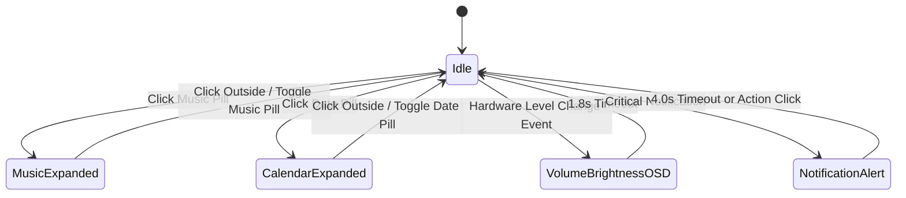

# Sub-Plan 01: Top Bar & Dynamic Center Notch

> **Module Focus:** Top Bar (Left, Center Notch, Right)  
> **Target Crates:** `crates/beskar-ui`, `crates/beskar-shell`, `crates/beskar-services`, `crates/beskar-compositor`  
> **Upstream References:**  
> - `references/minflair/config/quickshell/Modules/Bar/` (Convex fillets, Notch geometry, Music widget)  
> - `references/capsule/crates/app/src/capsule/` (Dynamic island morphing state machine, satellites)  
> - `references/gpui-shell/crates/app/src/bar/` (LayerShell window setup, fractional scaling)  
> - `references/icebar/src/modules/tray.rs` (StatusNotifierItem D-Bus watcher)

---

## 1. Architectural Layout & Geometry

```
+-----------------------------------------------------------------------------------------------------------------------------+
| TOP BAR (Height: 40px, Layer: Top, Exclusive Zone: 40px)                                                                   |
|                                                                                                                             |
| [LEFT CLUSTER]                         [CENTER DYNAMIC NOTCH]                         [RIGHT CLUSTER]                       |
| ┌───┐ ┌──────────────┐ ┌─────────────┐   ╭─────────────────────────╮   ┌───────────────┐ ┌────────────────┐ ┌───┐           |
| │ 󰀻 │ │ WS: 1 ● 2  3 │ │  󰈹 󰨞 Zed │   │  󰃭 Oct 17  |  󰎆 Song   │   │  󰈹    󰨞   │ │ 󰍛  󰖩  󰁹 94% │ │ ⏻ │           |
| └───┘ └──────────────┘ └─────────────┘   ╰─────────────────────────╯   └───────────────┘ └────────────────┘ └───┘           |
|  (1)       (2)               (3)                     (4)                      (5)               (6)          (7)            |
+-----------------------------------------------------------------------------------------------------------------------------+
```

### Component Breakdown
1. **App Launcher Trigger (1)**: Dedicated pill/button that opens or toggles the Bottom Unified Launcher / Spotlight.
2. **Workspace Indicator (2)**: Interactive workspace switcher displaying active/inactive workspaces from Niri/Hyprland IPC.
3. **Workspace Open Apps & Active App (3)**:
   - Dynamic list of app icons currently open in the active workspace.
   - Distinct active/focused window pill showing focused window's application icon and window title with truncation.
4. **Dynamic Center Notch (4)**:
   - **Idle State**: Compact pill displaying formatted Date (`Oct 17, 12:08`) and interactive Music pill (`󰎆 Bohemian Rhapsody - Queen`).
   - **Expanded Music Player Card**: Triggered by clicking the music pill. Morphs into an expanded player card with album art, track scrub bar, playback controls, volume slider, and cava audio visualizer.
   - **Expanded Calendar Card**: Triggered by clicking the date pill. Morphs into an expanded calendar card hosting the `gpui_kit::component::calendar::Calendar` primitive.
   - **Hardware OSD Morph**: Automatically morphs for 1.8s when volume or display brightness changes occur.
5. **Taskbar Apps (5)**: Pinned and running applications with active dot indicators and window raise/focus action.
6. **System Status & Tray (6)**: StatusNotifierItem (SNI) D-Bus tray icons, Wi-Fi signal, Bluetooth, and Battery percentage.
7. **Power Menu Trigger (7)**: Quick button to trigger power options or session management.

---

## 2. Dynamic Notch State Machine & Morphing Geometry

The Center Notch uses a spring-driven state machine (`crates/beskar-ui/src/spring.rs` and `convex.rs`) with cubic Bézier fillets:



### Morphing Geometry Specifications

| Notch State | Width (px) | Height (px) | Content Elements | GPUI Kit Components |
| :--- | :--- | :--- | :--- | :--- |
| **Idle** | 280 – 340 | 32 | Date pill + Music pill + status dot | `Button`, `Badge` |
| **Music Expanded** | 460 | 160 | Album art (64x64), track title, artist, scrub slider, Prev/Play/Next buttons, cava visualizer, volume slider | `Slider`, `Button`, `Tooltip` |
| **Calendar Expanded** | 360 | 380 | Current month calendar grid, today highlight, upcoming agenda list | `Calendar`, `Button`, `Scrollable` |
| **Hardware OSD** | 260 | 56 | Device icon (Speaker / Backlight), percentage label, progress bar | `Slider`, `Label` |
| **Notification Alert**| 380 | 72 | App icon, summary, body preview, quick action buttons | `Button`, `Badge` |

---

## 3. Data Models & Service Bindings

### Compositor Workspace & Window State
```rust
// crates/beskar-core/src/models.rs

#[derive(Clone, Debug, PartialEq, Serialize, Deserialize)]
pub struct WorkspaceState {
    pub id: u32,
    pub name: String,
    pub is_active: bool,
    pub is_focused: bool,
    pub open_windows: Vec<WindowSummary>,
}

#[derive(Clone, Debug, PartialEq, Serialize, Deserialize)]
pub struct WindowSummary {
    pub id: u64,
    pub app_id: String,
    pub title: String,
    pub is_focused: bool,
    pub icon_path: Option<PathBuf>,
}
```

### Dynamic Notch State & Controller
```rust
// crates/beskar-shell/src/bar/notch_state.rs

#[derive(Clone, Copy, Debug, PartialEq, Eq)]
pub enum NotchMode {
    Idle,
    MusicCard,
    CalendarCard,
    HardwareOsd { kind: OsdKind },
    NotificationBanner { id: u32 },
}

#[derive(Clone, Copy, Debug, PartialEq, Eq)]
pub enum OsdKind {
    Volume,
    Brightness,
}
```

---

## 4. GPUI Kit Component Integration Matrix

1. **Calendar Card Integration**:
   - Use `gpui_kit::component::calendar::Calendar` directly inside the expanded card view:
   ```rust
   use gpui_kit::component::calendar::Calendar;

   Calendar::new("notch-calendar")
       .selected_date(self.selected_date)
       .on_select(cx.listener(|this, date, cx| {
           this.selected_date = date;
           cx.notify();
       }))
   ```
2. **Music Player Sliders**:
   - Track progress and volume use `gpui_kit::component::slider::Slider`:
   ```rust
   use gpui_kit::component::slider::Slider;

   Slider::new("music-scrub", self.track_progress)
       .min(0.0)
       .max(self.track_duration)
       .on_change(cx.listener(|this, val, cx| {
           this.seek_mpris(val);
       }))
   ```
3. **Interactive Buttons**:
   - All playback buttons (Play, Pause, Skip, Prev, Shuffle) and workspace pills use `gpui_kit::component::button::Button` with `ghost` or `subtle` styles.

---

## 5. Implementation Milestones

- [ ] **M1.1: Top Left Workspace & Window Dock**
  - Connect to `beskar_compositor::niri` and `hyprland` event streams.
  - Render workspace dots/pills with active workspace highlight.
  - Ingest open windows for active workspace; resolve desktop entry icon paths via `freedesktop-icons`.
  - Display focused window title with marquee or ellipsis truncation.
- [ ] **M1.2: Dynamic Center Notch Convex Fillet Host**
  - Implement convex shape shader or SVG fillet math from `references/minflair/Modules/Bar/Styles/Convex/ConvexShape.qml`.
  - Connect `SpringInterpolator` for smooth width, height, and border-radius transitions.
  - Wire default idle state: formatted clock/calendar pill and MPRIS metadata pill.
- [ ] **M1.3: Expanded Music Player Card**
  - Connect `beskar_services::mpris` (metadata, playback status, position ticker).
  - Implement album art image decoding via `image` crate with round-corner clipping.
  - Embed `gpui_kit::component::slider::Slider` for seek position and volume.
  - Connect `beskar_services::cava` audio visualizer bars into GPUI paint pass.
- [ ] **M1.4: Expanded Calendar Card**
  - Integrate `gpui_kit::component::calendar::Calendar`.
  - Display current day, month navigation, and quick upcoming events list.
  - Add auto-dismissal when clicking outside the notch bounds.
- [ ] **M1.5: Top Right Taskbar, SNI Tray & Power**
  - Connect `beskar_services::tray` (`StatusNotifierWatcher` on `org.kde.StatusNotifierWatcher`).
  - Wire battery percentage and charging state from UPower.
  - Wire Wi-Fi SSID and signal strength from NetworkManager.
  - Add Power menu trigger button.
