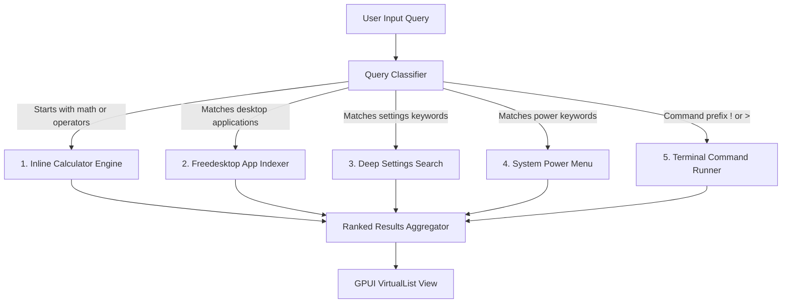

# Sub-Plan 03: Unified Bottom Launcher (Spotlight & Omni-Bar)

> **Module Focus:** Centered Bottom Floating Launcher / Spotlight  
> **Target Crates:** `crates/beskar-ui`, `crates/beskar-shell`, `crates/beskar-services`  
> **Upstream References:**  
> - `references/minflair/config/quickshell/Modules/Launcher/` (Unified Omni-Search, Apps, Settings, Power)  
> - `references/capsule/crates/app/src/capsule/widgets/search.rs` (Fuzzy scoring, keyboard navigation)  
> - `references/pleamar/src/desktop.rs` (Freedesktop `.desktop` parser and icon lookup)

---

## 1. Spatial Layout & Ergonomics

The Unified Launcher floats above the bottom of the screen (or centered, configurable), providing an instant keyboard-driven command surface inspired by Minflair and Raycast/Alfred.

```
+-----------------------------------------------------------------------------------------------------------------------------+
| FULL-SCREEN TRANSPARENT SCRIM (Dismiss on click outside / Esc)                                                              |
|                                                                                                                             |
|                        ┌──────────────────────────────────────────────────────────────────┐                                 |
|                        │  🔍  25 * 4                                                      │                                 |
|                        │  ──────────────────────────────────────────────────────────────  │                                 |
|                        │  [ All ]  [ 󰀻 Apps ]  [ 󰒓 Settings ]  [  Calculator ]  [ ⏻ Power ] │                                 |
|                        │  ──────────────────────────────────────────────────────────────  │                                 |
|                        │  RESULTS:                                                        │                                 |
|                        │    = 100                                        [ Press Enter ] │                                 |
|                        │     Calculation Result (Copy to clipboard)                       │                                 |
|                        │                                                                  │                                 |
|                        │  󰀻  Calculator (GNOME Calculator)                        [ App ] │                                 |
|                        │     Open math tool                                               │                                 |
|                        │                                                                  │                                 |
|                        │  󰒓  Keybinds: Calculator Shortcut                     [ Setting ] │                                 |
|                        │     Settings > Keybinds                                          │                                 |
|                        └──────────────────────────────────────────────────────────────────┘                                 |
|                             (Width: 640px, Floating Bottom Offset: 64px)                                                    |
+-----------------------------------------------------------------------------------------------------------------------------+
```

---

## 2. Multi-Mode Search & Execution Engine

The search query is parsed in real time across 5 core dispatchers:



### 1. Freedesktop Application Launcher
- Reads system and user applications from `/usr/share/applications` and `~/.local/share/applications`.
- Parses desktop files using `freedesktop-desktop-entry`.
- Resolves high-resolution themed icons via `freedesktop-icons`.
- Caches app index in memory with file watcher updates using `notify` crate.
- Fuzzy scoring algorithms: Prefix match > Token match > Substring match > Frequency of use.

### 2. Deep Settings Search
- Indexes all settings pages, sub-views, and keybinding actions from Standalone Settings.
- Querying `"volume"`, `"bluetooth"`, `"keybind"`, or `"wallpaper"` produces direct deep-link items that open the Settings window at the exact tab and highlights the target control.

### 3. Inline Calculator & Unit Converter
- Evaluates mathematical expressions instantly using an AST-based math evaluator (supporting `+`, `-`, `*`, `/`, `^`, parentheses, `sqrt`, `sin`, `cos`, `tan`, `pi`, `e`).
- Automatically handles unit conversions (e.g. `"50 kg in lbs"`, `"100 usd in eur"`).
- Pressing `Enter` copies the evaluated answer directly to the system clipboard via `arboard`.

### 4. Power Menu Commands
- Recognizes power keywords: `"shutdown"`, `"reboot"`, `"restart"`, `"lock"`, `"logout"`, `"sleep"`, `"suspend"`.
- Renders dedicated action cards with confirmation dialogs or direct execution.

---

## 3. Keyboard-First Interaction & Focus Trapping

1. **Auto-Focus**: The search input automatically captures keyboard focus when the launcher is opened.
2. **Key Bindings**:
   - `Down` / `Ctrl+N` / `Tab`: Move selection to the next item.
   - `Up` / `Ctrl+P` / `Shift+Tab`: Move selection to the previous item.
   - `Enter`: Execute the selected item (launch app, copy calculation, trigger power action).
   - `Esc`: Close the launcher.
   - `Alt+1` .. `Alt+5`: Quickly filter categories (`All`, `Apps`, `Settings`, `Calc`, `Power`).

---

## 4. GPUI Kit Component Bindings

```rust
use gpui_kit::component::{
    badge::Badge,
    button::Button,
    input::Input,
    scroll::Scrollable,
};

// Search Input using GPUI Kit
Input::new("launcher-search-input")
    .placeholder("Search apps, settings, calculate (25 * 4), or power...")
    .value(self.query.clone())
    .prefix_icon("search")
    .autofocus(true)
    .on_change(cx.listener(|this, val, cx| {
        this.update_query(val);
    }));
```

---

## 5. Implementation Milestones

- [ ] **M3.1: Launcher Layer-Shell Surface & Geometry**
  - Anchor floating window to bottom center with smooth spring entrance animation.
  - Set up focus trap and backdrop dismiss.
- [ ] **M3.2: Freedesktop Desktop Application Engine**
  - Implement async desktop indexer with icon cache.
  - Implement fuzzy matching with usage frequency weighting.
- [ ] **M3.3: Inline Calculator & Math Evaluator**
  - Build arithmetic expression parser.
  - Format results and bind clipboard copy on `Enter`.
- [ ] **M3.4: Deep Settings & Power Menu Integration**
  - Build searchable settings registry.
  - Wire power actions via `systemd-logind` / compositor IPC.
- [ ] **M3.5: Category Filter Chips & Keyboard Navigation**
  - Implement keyboard navigation loop (Up, Down, Enter, Tab).
  - Add category filter pills with active state styling.
