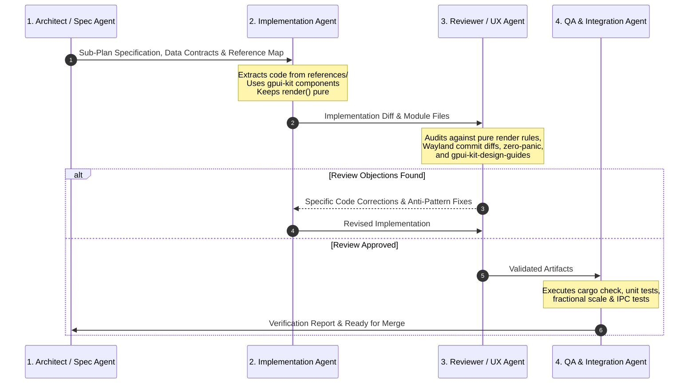

# Sub-Plan 05: Multi-Agent Execution Framework & QA Protocol

> **Module Focus:** Engineering Governance, Multi-Agent Coordination, and Automated QA  
> **Target:** Seamless parallel execution across 2–4 specialized agents for future feature iterations  
> **Enforcement:** Mandatory gate before any PR or branch merge

---

## 1. The 4-Agent Specialized Orchestration Model

To eliminate the recurring bugs of single-agent workflows (such as layer-shell lockups, blocking loops, memory leaks, and UI regressions), all feature implementations are executed through a strict **4-Agent Pipeline**:



---

## 2. Agent Roles & Directives

### Agent 1: Architect / Spec Agent
- **Responsibilities**:
  - Researches upstream working code in `references/` (`capsule`, `minflair`, `wayle`, `pleamar`, `gpui-shell`).
  - Drafts exact Rust struct and enum definitions.
  - Specifies Wayland layer-shell geometry (anchors, margins, exclusive zones, keyboard interactivity).
  - Selects the mandatory `gpui-kit` primitives to be used.
- **Handoff Artifact**: Detailed sub-plan with type signatures and references checklist.

### Agent 2: Implementation Agent
- **Responsibilities**:
  - Author the implementation files in `crates/beskar-*`.
  - Reuses proven upstream logic rather than writing novel protocol handlers.
  - All background D-Bus and socket loops must use Tokio runtime channels.
  - Ensures zero blocking code on GPUI's main thread.
- **Handoff Artifact**: Clean, compiling code diff.

### Agent 3: Reviewer / UX & Security Agent
- **Mandatory Review Checklist**:
  1. **Pure `render()` Policy**: Verify that `render()` contains NO side-effects, NO `window.focus()`, NO `cx.notify()`, and NO `spawn()`.
  2. **Layer-Surface Commit Safety**: Ensure all layer-surface mutations are guarded by cached diff comparisons to prevent compositor redraw loops.
  3. **Zero-Panic Guarantee**: Scan for any instances of `.unwrap()`, `.expect()`, or manual panics; ensure all errors use `anyhow::Result` or domain error enums.
  4. **GPUI Kit Compliance**: Confirm that common controls use `gpui-kit` primitives rather than raw `div()`s with custom event handlers.
  5. **Visual Craftsmanship**: Ensure adherence to spacing (4px/8px grid), typography hierarchies, and contrast standards defined in `.agents/skills/gpui-kit-design-guides/`.
- **Handoff Artifact**: Code review sign-off or structured fix requests.

### Agent 4: QA & Integration Agent
- **Responsibilities**:
  - Executes build verification: `cargo check --workspace` and `cargo test --workspace`.
  - Validates IPC responsiveness under simulated Niri/Hyprland event loads.
  - Tests window resize, multi-monitor configuration, and fractional scaling (1.25x, 1.5x, 1.75x) without surface clipping.
- **Handoff Artifact**: QA Pass Report.

---

## 3. Automated QA & Build Verification Commands

```bash
# 1. Format and Style Check
cargo fmt --check

# 2. Strict Compiler Verification
cargo check --workspace --all-targets

# 3. Linter Inspection
cargo clippy --workspace -- -D warnings

# 4. Test Suite Execution
cargo test --workspace
```

---

## 4. Release Readiness Criteria

Before any slice is marked complete, it must satisfy all 5 criteria:
1. **Compilation**: Workspace compiles without any warnings under `cargo check`.
2. **Zero Crashes**: Application boots, opens and closes all drawers and dialogs without runtime panic.
3. **Responsive Frame Rate**: Maintains stable 60/120 FPS during notch morphing and drawer transitions.
4. **Clean Compositor Logs**: No Wayland layer-shell protocol error logs in `niri` or `hyprland`.
5. **Specification Compliance**: All UI elements match the approved Master Shell Blueprint.
