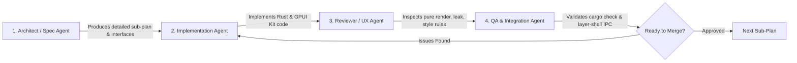

# Master Shell Blueprint: Beskar Unified Desktop Shell

> **Status:** Approved Architecture Plan  
> **Target Framework:** Rust + GPUI (`gpui-kit` component library)  
> **Compositor Target:** Wayland (Niri & Hyprland via `wlr-layer-shell`)  
> **Reference Archetypes:** Minflair (`references/minflair`), Capsule (`references/capsule`), Pleamar (`references/pleamar`), Wayle (`references/wayle`)

---

## 1. Executive Vision & Architectural Summary

Beskar is a next-generation desktop shell engineered for Wayland compositors (primarily Niri and Hyprland). It combines the fluid, convex-filleted spatial ergonomics of **Minflair** and **Capsule** with the zero-latency rendering and high-performance layout engine of **GPUI** and **`gpui-kit`**.

### Spatial Layout Matrix

```
+-----------------------------------------------------------------------------------------------------------------------------+
| TOP BAR: [App Launch] [WS: 1 (●) 2 3 |  󰸹 󂸞 | Active: Zed (main.rs)] --- [ 󰳭 Oct 17 | 󰾦 Song Title ] --- [ 󰸹  󂸞 | 󰽛 󱖩 󰱹 | ⏻ ] |
+-----------------------------------------------------------------------------------------------------------------------------+
|                                                           |                                                                 |
|   MIDDLE-LEFT DRAWER:                                     |   MIDDLE-RIGHT DRAWER:                                          |
|   ┌──────────────────────────────────────────────────┐   |   ┌────────────────────────────────────────────────────────┐   |
|   │  GitHub Dev Dashboard                           │   |   │ 󱒓 Control Center                                        │   |
|   │ 1,842 contributions in the last year             │   |   │ [ 󱖩 Wi-Fi ]  [ 󰮯 Bluetooth ]  [ 󰽛 DND ]  [ 󰳡 Night ] │   |
|   │ [■■■■■■■■■■■■■■■■■■■■■■■■■■■■■■■■■■■■■■■■■■■■■■]  │   |   │ Output Sink: PipeWire Headphones (HD 650)               │   |
|   │ Current Streak: 48 days | Active PRs: 3          │   |   │ Volume:     [=========O=============] 68%               │   |
|   │ Active Workspace Vitals: CPU 12% | RAM 4.2GB     │   |   │ Brightness: [==============O========] 80%               │   |
|   └──────────────────────────────────────────────────┘   |   │ Battery: 94% (Discharging, 6h 12m) | Balanced Mode     │   |
|                                                           |   └────────────────────────────────────────────────────────┘   |
|                                                           |                                                                 |
|                                                           |                                                                 |
+-----------------------------------------------------------------------------------------------------------------------------+
|                                     BOTTOM UNIFIED BAR (SPOTLIGHT / LAUNCHER):                                              |
|            ┌────────────────────────────────────────────────────────────────────────────────────────────────────┐                 |
|            │  🔍 Search apps, settings, run commands, math calculations (25 * 4), or power actions...    │                 |
|            │  [ All ]  [ 󰰻 Apps ]  [ 󱒓 Settings ]  [  Calculator ]  [ ⏻ Power ]                          │                 |
|            └────────────────────────────────────────────────────────────────────────────────────────────────────┘                 |
+-----------------------------------------------------------------------------------------------------------------------------+
```

---

## 2. Core Architectural Pillars

### Pillar A: Standardized `gpui-kit` UI Primitives
Never construct raw unstyled `div`s with custom ad-hoc interactive behavior for common controls. All UI components strictly use **`gpui_kit::component`**:
- **Sliders**: `gpui_kit::component::slider::Slider` (Volume, Brightness).
- **Toggles & Switches**: `gpui_kit::component::switch::Switch` (Wi-Fi, Bluetooth, DND, Night Light).
- **Date & Calendar**: `gpui_kit::component::calendar::Calendar` (Date notch drop-down, agenda).
- **Buttons & Chips**: `gpui_kit::component::button::Button`, `Chip`, `Badge`.
- **Search Inputs**: `gpui_kit::component::input::Input` with debounce, clear triggers, and prefix icons.
- **Scrollable Containers**: `gpui_kit::component::scroll::Scrollable` with auto-managed scrollbars.
- **Tabs & Sidebars**: `gpui_kit::component::tabs::Tabs`, `Sidebar` for Standalone Settings.
- **Data Tables & Lists**: `gpui_kit::component::table::DataTable`, `VirtualList` for package management and high-volume app search.

### Pillar B: Wayland Layer-Shell Scrim & Geometry Management
1. **Zero Layer-Surface Overlap Conflicts**:
   - The Top Bar is permanently anchored to `TOP | LEFT | RIGHT` with an exclusive zone corresponding to its natural height (40px).
   - Drawers and Modals (Middle-Left GitHub drawer, Middle-Right Control Center, Bottom Unified Launcher) use **Full-Screen Transparent Scrims** (`TOP | BOTTOM | LEFT | RIGHT`) with `exclusive_zone = -1` (or 0) and `keyboard_interactivity = OnDemand`.
   - Clicking outside the inner panel card on the transparent scrim automatically requests overlay dismissal.
2. **Commit Loop Prevention**:
   - In GPUI Wayland layer surfaces, setter calls (`set_keyboard_interactivity`, `set_exclusive_zone`) unconditionally trigger `surface.commit()`, causing compositor `configure` and UI redraw loops.
   - All surface state updates must be guarded by strict change diffs:
     ```rust
     if self.cached_keyboard_mode != desired_mode {
         self.cached_keyboard_mode = desired_mode;
         window.set_keyboard_interactivity(desired_mode);
     }
     ```

### Pillar C: Async Isolation & Zero Main-Thread Blocking
1. **Dedicated Tokio Reactor**:
   - GPUI’s UI thread (`cx.update`, `render()`) must **never** execute blocking D-Bus calls, file I/O, or shell commands (`nmcli`, `wpctl`, `brightnessctl`, `sysinfo`).
   - All background services (`zbus` 5.x, NetworkManager, BlueZ, PipeWire, GitHub API, Freedesktop desktop scanner) run inside a Tokio runtime thread.
2. **Channel-Based Telemetry**:
   - Background tasks publish immutable state snapshots through `tokio::sync::broadcast` or `mpsc` channels into GPUI entities.
   - `render()` remains 100% pure, side-effect free, and declarative.

---

## 3. Spatial Shell Modules Specification

| Module Location | Visual Representation | Key Capabilities | Upstream Reference |
| :--- | :--- | :--- | :--- |
| **Top Left** | App Launcher Button + Workspace Indicator + Active App | • Quick click triggers Bottom Unified Launcher<br>• Workspace switcher with open app icons<br>• Current active window icon + title | `references/gpui-shell`<br>`references/inir` |
| **Top Center Notch** | Dynamic Island / Notch (Convex fillets) | • Default: Date/Time + Music pill<br>• Click Music: Expands into full player bar + visualizer<br>• Click Date: Expands into GPUI Kit Calendar card<br>• Hardware OSD toasts (volume/brightness) | `references/minflair`<br>`references/capsule` |
| **Top Right** | Taskbar Pinned Apps + System Tray + Power | • Pinned / running app dock<br>• StatusNotifierItem (SNI) D-Bus tray icons<br>• Battery, Wi-Fi, Audio status pills<br>• Power session trigger | `references/icebar`<br>`references/wayle` |
| **Middle Left** | GitHub Contribution & Dev Dashboard Drawer | • GitHub contribution activity heatmap<br>• Commit streak counter, active PR review status<br>• Workspace CPU / RAM / Disk load vitals | `references/minflair`<br>`references/suzuha` |
| **Middle Right** | Control Center Panel Drawer | • Quick toggle matrix (Wi-Fi, BT, DND, Night Light)<br>• PipeWire audio sink selector & volume slider<br>• Display backlight brightness slider<br>• Power profiles (Performance / Balanced / Eco) | `references/wayle`<br>`references/minflair` |
| **Bottom Center** | Unified Spotlight / Launcher Bar | • Omni-search: Desktop apps, Settings, Files<br>• Real-time inline math & unit calculator (`25 * 4`)<br>• Power commands (`lock`, `reboot`, `shutdown`)<br>• Keyboard navigation (Up/Down/Enter/Esc) | `references/minflair`<br>`references/capsule` |
| **Standalone Window** | Standalone Settings & Extension Manager | • Keybinds Cheat Sheet & Custom Shortcut Editor<br>• Package & Extension Manager (plugins/themes)<br>• Appearance / Theme HSL color engine & blur | `references/capsule`<br>`references/wayle` |

---

## 4. Multi-Agent Implementation & Review Protocol

To ensure faultless execution, every functional slice will be designed, implemented, and reviewed through a structured **4-Agent Protocol**:



1. **Agent 1: Architect / Spec Agent**
   - Researches reference crates (`references/capsule`, `references/minflair`, `references/wayle`).
   - Defines strict Rust data models, D-Bus interfaces, and `gpui-kit` component bindings.
   - Formulates the exact sub-plan milestone and interface signatures before any coding begins.
2. **Agent 2: Implementation Agent**
   - Extracts battle-tested logic from references without reinventing protocols.
   - Implements GPUI views using `gpui-kit` primitives (`Button`, `Slider`, `Switch`, `Input`, `Calendar`).
   - Connects async Tokio background channels to GPUI entities.
3. **Agent 3: Reviewer / UX & Security Agent**
   - Audits code against:
     - Pure declarative `render()` (no `window.focus()`, `cx.notify()`, or spawn inside `render()`).
     - Zero unwrap / panic policy (`anyhow::Result` / `thiserror`).
     - Wayland layer-shell state commit loops.
     - Spacing, typography, and contrast rules in `gpui-kit-design-guides`.
4. **Agent 4: QA & Integration Agent**
   - Runs `cargo check --workspace` and unit tests.
   - Validates multi-monitor behavior, fractional scaling edge cases, and keyboard navigation.

---

## 5. Master Roadmap & Sub-Plan Index

| Plan Document | Scope & Focus |
| :--- | :--- |
| **[`01_TOP_BAR_AND_DYNAMIC_NOTCH.md`](file:///home/nsp/Documents/p/beskar/beskar/docs/plans/01_TOP_BAR_AND_DYNAMIC_NOTCH.md)** | Top Bar: Left (Launcher trigger, Workspaces, Open app icons, Active title), Center (Convex Dynamic Notch, Date/Music pills, Expanded Music & Calendar cards), Right (Taskbar, SNI Tray, Power). |
| **[`02_MIDDLE_DRAWER_PANELS.md`](file:///home/nsp/Documents/p/beskar/beskar/docs/plans/02_MIDDLE_DRAWER_PANELS.md)** | Left Drawer (GitHub contribution graph, commit streaks, PR tracking, system vitals) + Right Drawer (Control Center quick toggles, PipeWire sink selector, volume/brightness sliders, power profiles). |
| **[`03_UNIFIED_BOTTOM_LAUNCHER.md`](file:///home/nsp/Documents/p/beskar/beskar/docs/plans/03_UNIFIED_BOTTOM_LAUNCHER.md)** | Unified Spotlight bar: App search, Settings deep-links, inline Math/Calculator solver, Power menu commands, keyboard navigation, GPUI Kit `Input` & `VirtualList`. |
| **[`04_STANDALONE_SETTINGS_AND_EXTENSIONS.md`](file:///home/nsp/Documents/p/beskar/beskar/docs/plans/04_STANDALONE_SETTINGS_AND_EXTENSIONS.md)** | Standalone Settings App: Keybinds Cheat Sheet & Custom Shortcut Editor, Package & Extension Manager, Appearance & HSL Theme customizer using GPUI Kit `Sidebar`, `Tabs`, `DataTable`. |
| **[`05_MULTI_AGENT_EXECUTION_AND_QA.md`](file:///home/nsp/Documents/p/beskar/beskar/docs/plans/05_MULTI_AGENT_EXECUTION_AND_QA.md)** | 4-Agent lifecycle, verification checklists, test matrix, Wayland layer-surface protocols, and release readiness criteria. |
| **[`06_CONVEX_EDGE_MORPHING_AND_HOT_EDGES.md`](file:///home/nsp/Documents/p/beskar/beskar/docs/plans/06_CONVEX_EDGE_MORPHING_AND_HOT_EDGES.md)** | Full-screen scrim host, convex Bézier edge fillets (`ConvexDrawerShape`), flush edge docking (Left/Right/Bottom), Wayland hot-edges trigger strips, and slide-in morphing animations. |
